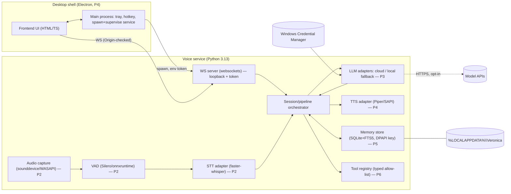

# Veronica — Architecture Decision Record & Foundation Design

Status: **Proposed** · Date: 2026-10-21 · Target: Windows 11, i7-8665U (4C/8T, AVX2, no AVX-512), 16 GB RAM, Intel UHD 620.
Evidence labels: **[V]** verified on this machine today · **[R]** recommendation · **[A]** assumption (not yet measured).

## 1. Context
Veronica is a voice-first personal assistant. The binding constraints are (a) conversational latency, (b) 16 GB RAM shared
with a normal desktop (measured free RAM with Chrome/Edge/WhatsApp/IDE open: **~6.1 GB [V]**), (c) no usable GPU for ML
(UHD 620, 1 GB reported adapter RAM [V]), (d) privacy: the microphone and personal memory are the crown jewels.

## 2. Options considered

| | A. **Electron shell + Python voice service** | B. **Tauri 2 shell + Python sidecar** | C. **Single Python process (PySide6/Qt)** | D. **Headless service + browser UI** |
|---|---|---|---|---|
| Toolchain present today | Node 24, npm, pnpm **[V]** | Needs Rust + MSVC C++ build tools — **neither present [V]** (`cargo/rustc/cl` missing; VS 2019 Build Tools folder has no MSVC toolset) | Python present; PySide6 ~hundreds MB wheel | Node/Python present |
| Idle shell RAM | ~150–300 MB **[A]** | ~40–100 MB (system WebView2, runtime 155.x present **[V]**) **[A]** | ~80–150 MB **[A]** | Browser tab cost, no tray/global hotkey |
| Packaging risk | Medium: big installer (~100 MB+), code-signing, but well-trodden | **High here**: first build requires multi-GB toolchain install; Rust↔Python sidecar lifecycle is extra surface | Medium: PyInstaller + Qt + ML DLLs is a known pain | Low, but not a "product" |
| UI richness / dev speed | High (web stack) | High (web stack) | Medium (QML/Widgets) | High |
| Voice/ML ecosystem fit | Voice in Python sidecar (same as B) | Same | Native, no IPC | Same |
| Components to ship | 2 processes (+ models) | 3 runtimes (Rust, WebView2, Python) | 1 process | 2 |

### Decision **[R]**
**Architecture: "thin shell + local voice service over authenticated loopback WebSocket", shell = Electron by default,
decided finally by a measured spike in roadmap P4.** The service/protocol (the part that carries all the risk) is
shell-agnostic, so the shell choice is reversible at low cost. Option C is the fallback if two-process lifecycle bugs
dominate. Option B is revisited only if measured Electron idle RSS exceeds the 250 MB budget, because adopting it now
means installing Rust + MSVC before a single line of product code runs.

Why Python for the voice service **[R]**: STT/VAD/TTS runtimes with usable CPU performance (`faster-whisper`/CTranslate2,
`onnxruntime`, Silero VAD, Piper) are Python-first. The *only* hot loop that needs native speed is already native code
inside those wheels. Python version: **3.13**, not the machine default 3.14 — see §6.

## 3. Challenge to the proposal (what I would cut or distrust)

| Item | Verdict | Reason |
|---|---|---|
| WebSocket between shell and service | **Keep, but minimal** | Streaming deltas/audio-state events are naturally bidirectional. Cost is auth/Origin handling — implemented and tested in the foundation. Named pipes would avoid the browser-origin attack class entirely but make a browser-UI dev mode harder. |
| Wake-word detection | **Cut from v1** | Continuous mic + inference on a 15 W CPU; privacy and battery cost; push-to-talk meets every acceptance criterion. |
| Local 7B+ LLM | **Cut** | 7B Q4 ≈ 4.5 GB + KV cache vs ~6 GB free **[V free RAM]** ⇒ paging ⇒ latency collapse. Cloud LLM default; optional ≤3B local fallback **[A]**. |
| Vector DB / embeddings | **Cut until FTS5 fails** | Extra model download + RAM; SQLite FTS5 covers "what did I say about X". |
| Separate Rust core | **Cut** | A third language with no workload that needs it. |
| Autonomous planner / agent loop | **Cut** | Multiplies injection surface; single-turn typed tool calls first. |
| Three-process split (shell + service + "tools" daemon) | **Cut** | Tools run in the service behind an allow-list; a separate daemon buys little at this stage. |
| GPU acceleration (OpenVINO/DirectML) for UHD 620 | **Defer** | Gains on iGPU for Whisper-class models are uncertain and add driver/packaging risk **[A]**; benchmark CPU int8 first. |
| Cloud STT as default | **Reject as default** | Sends raw audio off-device; allowed only as explicit opt-in adapter. |

Latency risks to design around **[A until measured in P2]**: STT model size on 4 physical cores; Python GIL contention between
audio-capture thread and inference (keep capture in its own thread/process, queue bounded); TTS first-chunk time (stream
by sentence); cold-start model load (keep service resident, lazy-load adapters); Windows Defender real-time scanning of
model files on first load (MsMpEng was resident at 334 MB **[V]**; its effect on load time is **[A]**, unmeasured).

Packaging risks: PyInstaller + `onnxruntime`/`ctranslate2` native DLLs; code signing/SmartScreen;
antivirus false positives on PyInstaller bootloaders; per-user (non-admin) install path for models (~0.5–2 GB) kept
outside the installer in `%LOCALAPPDATA%`.

Memory-pressure risks: Electron renderer + service + STT model + TTS model + (optional) local LLM all resident. Budget in §7.

## 4. Dependency map



| Layer | Dependency | Required by | On this machine **[V]** | Notes |
|---|---|---|---|---|
| Frontend | Node ≥ 20 (24.13.1 present), npm 11 / pnpm | UI build, integration test | present | Foundation test uses **no npm packages** (built-in `WebSocket`, `node:test`). |
| Desktop shell | Electron (npm) — or Rust+MSVC for Tauri | P4 | Electron: downloadable; Tauri: **missing toolchain** | WebView2 runtime 155.x present. |
| Voice service | CPython 3.13 | P0+ | 3.13.7 at `C:\Python313` and 3.14.4 default | Pin to 3.13. |
| Voice service | `websockets` (pure Python) | P0 | installed in project venv | Only runtime dep today. |
| Audio I/O | `sounddevice` (PortAudio wheel) | P2 | not installed; Realtek mic present | |
| Speech | `faster-whisper` → `ctranslate2`, `onnxruntime`, Silero VAD | P2 | not installed | AVX2 present **[V]**; no AVX-512. |
| TTS | Piper (ONNX) or SAPI | P4 | not installed | |
| Media | ffmpeg 9.0 | optional (file decode, tests) | present | Not required at runtime for live mic. |
| Model adapters | HTTPS client + provider SDK/`httpx` | P3 | — | Keys via `keyring` → Credential Manager. |
| Storage | `sqlite3` (stdlib, FTS5) | P5 | stdlib | Verify FTS5 compiled in before P5. |
| Tool execution | none external (typed Python functions) | P6 | — | No shell-out. |
| Tooling | git 2.51, pwsh 7.6, VS Code | all | present | Repo has **no commits yet [V]**. |

## 5. Repository structure and boundaries

```
veronica/
├─ docs/                 ARCHITECTURE.md  THREAT_MODEL.md  ROADMAP.md  FINDINGS.md
├─ services/
│  └─ voice/             Python package `veronica_voice` — the ONLY place that touches mic, models, keys, memory
│     ├─ src/veronica_voice/
│     │   protocol.py    wire format + strict inbound validation (stdlib only)
│     │   adapters.py    Protocol seams (LLM now; STT/TTS added when a backend exists)
│     │   server.py      loopback WS, auth, session loop
│     └─ tests/
├─ apps/
│  └─ desktop/           (P4) Electron/Tauri shell + UI. No access to mic/keys/models; talks WS only.
├─ tests/integration/    cross-runtime tests (Node ↔ Python), no npm deps
└─ scripts/              setup.ps1 (project-local venv)  verify.ps1 (one-command check)
```
Boundary rules **[R]**: (1) the shell never imports service code and the service never imports shell code — the wire
protocol is the contract; (2) only `services/voice` may read API keys or open audio devices; (3) adapters are selected at
composition time in one place (`server.py`) so a backend can be swapped without touching the orchestrator; (4) nothing under
`services/voice` may execute shell commands (enforced by a grep test from P6).

## 6. Python version decision
The machine default `python` is 3.14.4, with 3.13.7 also installed **[V]**. A PyPI metadata check (FINDINGS.md) shows that the
latest releases of `onnxruntime`, `ctranslate2`, `faster-whisper`, `sounddevice`, `torch`, `piper-tts` and `websockets` publish
cp313 **and** cp314 Windows wheels **[V: wheels exist]** — so my initial worry about 3.14 wheel gaps was **not** supported by evidence.
What is *not* verified is that those wheels run correctly (DLL loading, audio, performance) on 3.14. I still pin 3.13 **[R]**
because it is one release more mature for native extensions and PyInstaller hooks **[A]**, and `pyproject.toml` pins
`>=3.12,<3.14` with `setup.ps1` using 3.13 explicitly. Revisit when P2 has a runtime test matrix.

## 7. Hardware-specific risks (16 GB RAM, integrated GPU)

| Risk | Evidence / basis | Mitigation |
|---|---|---|
| RAM headroom is much less than 16 GB | **[V]** 15.8 GB total, 6.1 GB free with normal apps; Chrome ×N ≈ 1.3 GB+, WebView2 468 MB, Defender 334 MB, memory compression 333 MB | Budget the whole app ≤ 2.5 GB resident: shell ≤ 250 MB, service+STT ≤ 1.2 GB, TTS ≤ 300 MB, headroom. No local ≥7B LLM. |
| CPU-only inference on a 15 W Whiskey Lake part | **[V]** 4C/8T i7-8665U, AVX2 yes, AVX-512 no | `int8` quantization; `base.en`/`small.en` only; set inference threads to ≤ 4 (physical cores) so UI/audio thread stay responsive; benchmark plugged-in *and* on battery. |
| Thermal throttling / battery mode | **[A]** typical for U-series ultrabooks | Measure p95 not mean; gate P2 on battery results; don't poll. |
| iGPU gives no ML speed-up and shares system RAM | **[V]** UHD 620, 1 GB reported VRAM (shared) | CPU path first; treat OpenVINO/DirectML as an experiment. |
| Disk space for models/installers | **[V]** 75.8 GB free of ~421 GB | Fine, but keep models out of repo and installer. |
| Audio device chaos (virtual devices) | **[V]** Steam Streaming Microphone, FxSound, Intel Display Audio, Realtek all present | Explicit device selection UI; handle device hot-swap; test with the real default Realtek mic; mute must close the stream. |
| Antivirus real-time scanning of model loads and unsigned binaries | **[V]** Defender active (MsMpEng 334 MB) | Lazy-load once and keep resident; document exclusions *without* auto-adding them; sign release builds. |
| Windows long paths disabled/unknown | not confirmed (`LongPathsEnabled` unreadable) | Keep repo path short; installer into `%LOCALAPPDATA%`. |
| Background apps compete (WhatsApp desktop 286 MB resident) | **[V]** | Report RSS in the UI's diagnostics; degrade (smaller model) rather than swap. |

## 8. What the foundation proves (and doesn't)
Proves: Node↔Python process spawn, token handshake, Origin rejection, streaming-delta envelope, adapter seam, one-command
verification. **Does not** prove: any audio capture, model latency, shell memory, or packaging. Those are P2/P4 gates.
